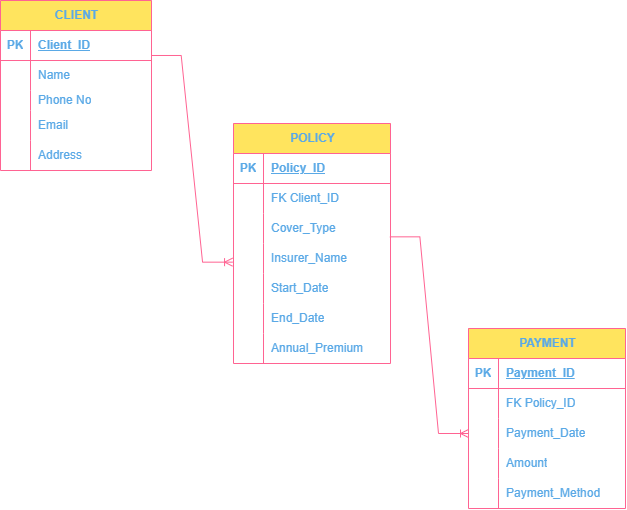

## Portfolio 1: Database Design and Modelling

##Case Study

This is a case study of Impact Insurance Brokers whose core business is to intermediate between clients purchasing insurance and insurers who provide coverage for clients' insurance needs. The database system is designed to provide a means of accurately storing, retrieving and updating client data, policies and payments.  It also provides a way to track client payments and identify their policies nearing expiry so that they can follow up on renewals.

## ER Diagram

[Open the editable diagram](MIT8103_Portfolio1_ERD.drawio)

## Relational Schema

CLIENT(Client_ID PK, Client_Name, Phone, Email, Address)

POLICY(Policy_ID PK, Client_ID FK → CLIENT.Client_ID, Cover_Type, Insurer_Name, Start_Date, End_Date, Annual_Premium)

PAYMENT(Payment_ID PK, Policy_ID FK → POLICY.Policy_ID, Payment_Date, Amount, Method)

## Keys and Constraints

1. A Client's Name is required, but phone, email, and address may be blank.
2. A Policy's End date must be after the Policy's Start date.
3. Required Policy fields include - Client ID, Cover Type, Insurer, Start and end dates, annual premium.
4. Required Payment fields include - Policy_ID, Payment_Date, Amount, and Method.
5. Annual_Premium and Payment amounts must be greater than zero
6. Each Primary Key (PK) uniquely identifies a row and is not blank.
7. POLICY.Client_ID must match a Client; also, PAYMENT.Policy_ID must match a policy.
